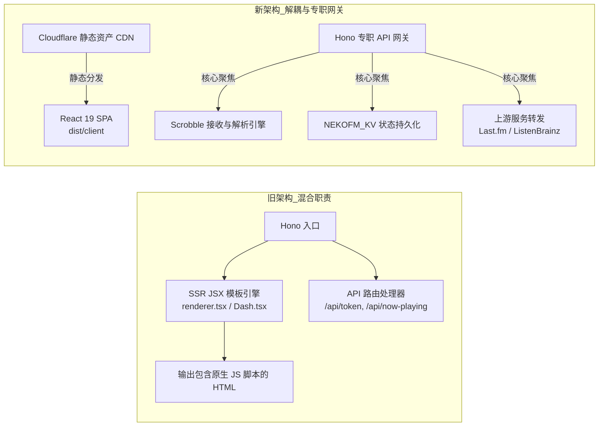
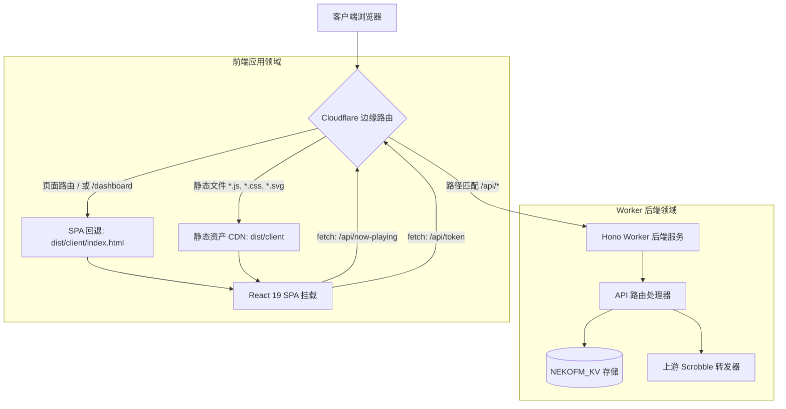
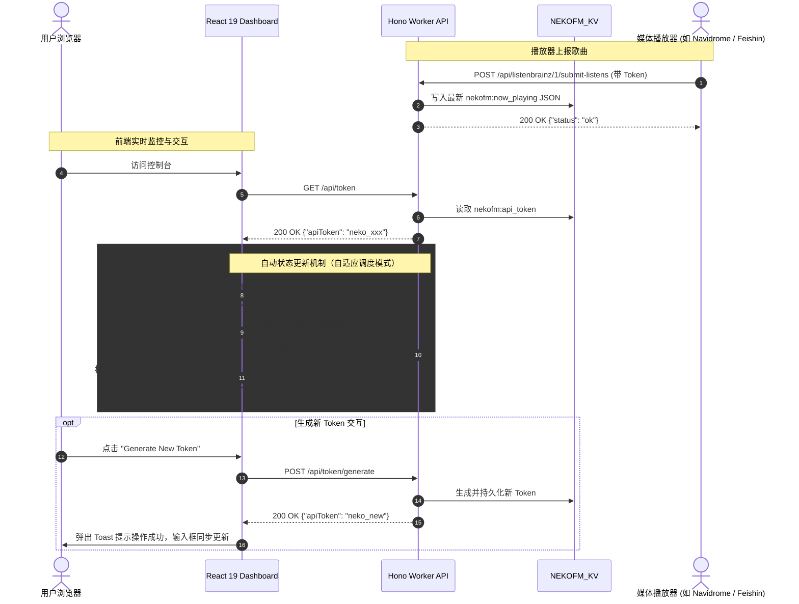
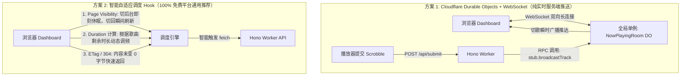

# 前端 Dashboard 迁移至 React 19 技术评估与架构设计规范

## 1. 摘要与背景

本文档详细阐述了 **NekoFM** 前端 Dashboard 从现有的服务端渲染（Hono JSX SSR）及内联原生 JavaScript 架构，迁移至基于 **Cloudflare Workers with Static Assets** 托管的 **React 19 单页应用（SPA）** 的技术评估、架构重构设计与实施方案。

---

## 2. 技术评估：React vs. Preact 在 Cloudflare 平台上的表现

### 2.1 核心评估矩阵

| 评估维度 | React 19 | Preact 10（配合 `preact/compat`） | 在 NekoFM Dashboard 场景下的选型结论 |
| :--- | :--- | :--- | :--- |
| **产物体积（Gzipped）** | ~42 – 45 KB（`react` + `react-dom`） | ~3 – 4 KB（`preact`），加 compat 约 ~9 – 10 KB | Preact 体积约为 React 的 1/4。但在 Cloudflare 全球 Anycast CDN 边缘网络下，45 KB 的传输时间差异仅在 15 毫秒以内，对管理后台几乎无感。 |
| **组件库与 UI 生态** | **100% 原生无缝兼容**。主流 UI 库（Radix UI、Shadcn UI、Lucide 图标、TanStack Query、Sonner 等）开箱即用。 | 大部分标准库可通过别名运行，但深度依赖 React Fiber 内部机制、特定事件系统或复杂 ref 的 Headless UI 库易遇边界兼容问题。 | **选定 React**：NekoFM 后台后续需引入现代化图标、弹窗与状态组件，React 能确保零兼容负担。 |
| **状态响应与轮询** | 标准 Hooks（`useState`, `useEffect`），成熟的数据请求库（TanStack Query / SWR）。 | 标准 Hooks + 原生 `@preact/signals`（细粒度响应式）。 | 两者均能优雅处理 Now Playing 状态的定时轮询。 |
| **构建工具链（Vite 8）** | `@vitejs/plugin-react`（与 Vite 8 和 Bun 深度兼容）。 | `@preact/preset-vite`。 | 两者均能无缝集成 Vite 8 与 Tailwind CSS v4 (`@tailwindcss/vite`)。 |
| **边缘执行开销** | 作为静态静态资产分发，边缘 CPU 执行时间为 0。 | 作为静态静态资产分发，边缘 CPU 执行时间为 0。 | 运行时无额外计费开销。 |

### 2.2 Cloudflare 托管架构方案评估

对 Cloudflare 平台的三种部署架构进行了深度对比：

1. **方案 A：Cloudflare Workers with Static Assets（推荐并选定）**：
   - 在 `wrangler.jsonc` 中配置 `"assets": { "directory": "./dist/client" }`。
   - 静态 React SPA 产物由全球 CDN 边缘节点直接分发，`/api/*` 请求直接路由到现有的 Hono Worker。
   - **优势**：单仓库代码库、统一 `wrangler deploy` 单命令部署、同域名完全无跨域（零 CORS 消耗）、共享 `NEKOFM_KV` 绑定、原生支持 SPA 路由回退。
2. **方案 B：独立 Cloudflare Pages + Cloudflare Workers（前后端分离）**：
   - 独立 Pages 项目托管 SPA（如 `nekofm.pages.dev`），调用独立的 API Worker（`api.nekofm.workers.dev`）。
   - **缺点**：需在后端开启 CORS 中间件处理预检请求（OPTIONS），前端需注入环境变量，运维两个独立项目。
3. **方案 C：Cloudflare Pages 全栈应用（Pages Functions）**：
   - 将 Hono 路由全量移入 `functions/api/[[route]].ts`。
   - **缺点**：Pages Functions 属于旧版方案，Cloudflare 官方现已统一推进 Workers with Static Assets。

---

## 3. Hono API 网关与中间件职责处置

### 3.1 角色演进与职责重新定义

在原先架构中，Hono 兼具 HTML 组装渲染与后端 API 处理。重构后，**Hono 卸除所有页面渲染负担，专职作为纯 API 网关与 Scrobble 中间件**：



### 3.2 Hono 具体代码处置清单

1. **移除项（Delete / Deprecate）**：
   - 移除 `src/renderer.tsx`（基于 `hono/jsx-renderer` 与 `vite-ssr-components` 的 SSR 布局）；
   - 移除 `src/dashboard/Dash.tsx` 及其子组件中的 Hono JSX 与字符串拼接原生脚本；
   - 移除 `src/index.tsx` 中的页面路由（`app.get('/', ...)` 与 `app.get('/dashboard', ...)`）；
   - 移除 `vite-ssr-components` 依赖。
2. **保留并强化项（Retain & Enhance）**：
   - `src/index.tsx`：作为 Cloudflare Worker 入口，仅挂载纯 JSON API 子路由；
   - `/api/listenbrainz/*`：接收并解析客户端上报的 ListenBrainz v1 协议曲目；
   - `/api/token/*`：API Token 查询、重新生成与自定义更新；
   - `/api/now-playing`：实时返回曲目播放状态 JSON；
   - `src/services/storage.ts`：Token 生成算法及与 `NEKOFM_KV` 的读写。

---

## 4. 端到端边缘架构与请求时序

### 4.1 边缘分流架构 (Cloudflare Edge Routing)



### 4.2 曲目上报与客户端轮询时序图 (Sequence Diagram)



---

## 5. 状态同步升级评估：从“固定 4 秒轮询”到“全自动实时更新”

针对用户提出的“四秒轮询能否改为自动更新状态”，在 Cloudflare Workers 边缘无状态架构下，存在以下技术方案：



### 5.1 方案对比与选型

1. **方案 1：Cloudflare Durable Objects + WebSocket（真正的服务器主动 Push）**
   - **效果**：播放器一旦切歌，50ms 内浏览器自动同步。
   - **门槛**：需要 **Cloudflare Workers Paid 计划**（$5/月），免费计划不支持 Durable Objects。
2. **方案 2：智能自适应调度（Page Visibility + Duration 倒计时预测 + ETag 304）（推荐通用）**
   - **效果**：
     - **页面可见性感知**：切到后台标签页或窗口最小化时**立刻停止请求（0 流量、0 开销）**；切回前台瞬间（0ms）**自动即刻触发刷新**；
     - **歌曲时长感知**：根据 `duration_ms` 计算剩余播放时间，歌曲中段保持 15~20s 低频心跳，快播完前 5s 动态加速至 2s，精准捕捉切歌时刻；
     - **304 快速协商**：曲目未变时不重新序列化。
   - **优势**：**100% 适用于免费计划**，完全无需外部付费服务或复杂长连接维护，体验接近全自动。
3. **方案 3：混合兼容模式**
   - 优先尝试 WebSocket 连接；若未配置 DO 绑定，无缝降级为智能自适应调度。

---

## 6. 详细落地规划路线图

### 6.1 阶段一：工具链与构建配置调整
- 安装依赖：`react`, `react-dom`, `@types/react`, `@types/react-dom`, `@vitejs/plugin-react`, `lucide-react`。
- 移除依赖：`vite-ssr-components`。
- 配置 `vite.config.ts`：输出客户端 SPA 到 `dist/client`，保持 `@cloudflare/vite-plugin`。
- 配置 `tsconfig.json`：设置 `"jsx": "react-jsx"`，`"jsxImportSource": "react"`。
- 在 `wrangler.jsonc` 中增加静态资产绑定：
  ```jsonc
  "assets": {
    "directory": "./dist/client",
    "binding": "ASSETS",
    "not_found_handling": "single-page-application"
  }
  ```

### 6.2 阶段二：重构 Hono 入口与清理 SSR
- 精简 `src/index.tsx`，仅挂载 `/api/*` 路由。
- 增加 `/api/now-playing` 的 ETag / 条件请求支持。
- 删除 `src/renderer.tsx`、`src/dashboard/Dash.tsx` 及旧版 SSR 组件目录。

### 6.3 阶段三：开发 React 19 SPA 与智能自适应 Hook
- 搭建 `src/client/` 目录结构：
  - `index.html`：SPA 宿主 HTML。
  - `main.tsx`：React 19 挂载入口（`createRoot`）。
  - `App.tsx`：主布局容器。
  - `components/NowPlayingCard.tsx`：正在播放曲目响应式卡片。
  - `components/ApiTokenCard.tsx`：Token 展示、一键复制、重新生成与自定义编辑。
  - `components/Toast.tsx`：非阻塞式轻量操作反馈通知。
  - `hooks/useNowPlaying.ts`：**实现智能自适应调度 Hook**（Page Visibility 感知、歌曲剩余时长动态调频、切回前台瞬间刷新）。
  - `hooks/useApiToken.ts`：Token 查询与变更管理 Hook。

### 6.4 阶段四：验证与测试
- 运行 `bun run typecheck` 验证严格类型通过。
- 运行 `bun run build` 验证静态产物与 Worker 正确编译。
- 运行 `./test-api.sh` 确保 ListenBrainz 协议与 Token 鉴权完全正常。
